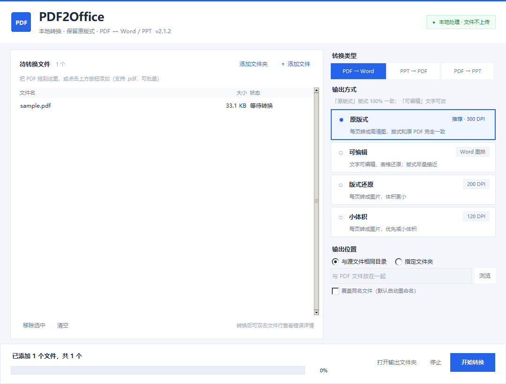

# PDF2Office

Windows 本地小工具，一个界面里做三种转换：

| 转换类型 | 输入 | 输出 |
| --- | --- | --- |
| **PDF 转 Word** | `.pdf` | `.docx` |
| **PPT 转 PDF** | `.ppt / .pptx / .pptm / .pps…` | `.pdf` |
| **PDF 转 PPT** | `.pdf` | `.pptx` |

- 转换完全在本机完成，文件不会上传
- 支持拖拽、批量、文件夹递归查找
- 每种转换都有四档输出，要**版式一模一样**还是**文字可编辑**自己选
- 大部分档位不需要装 Office



> **English:** An offline Windows app that converts PDF ↔ Word/PPT in one GUI —
> PDF→Word, PDF→PPT and PPT→PDF, each with four quality modes. Most modes need no
> Microsoft Office. Download the installer from the Releases page. MIT licensed.
> **This project is provided for study and technical exchange only, not as a
> commercial product. Use it only on documents you are entitled to process.**

> [!IMPORTANT]
> **特别说明（请先阅读）· 本项目仅供学习、研究与技术交流使用，不是商业产品，也不构成任何形式的服务承诺。**
> **继续下载、安装或使用即表示你已阅读并同意以下内容；首次启动需完整输入一句确认语句才可使用，如不同意请停止使用并删除本软件。**
>
> - 请只转换你**拥有合法权利**的文档，并遵守所在地法律法规；不要处理他人的受版权保护、涉密或受法律法规限制的材料。
> - 本工具不提供破解加密、绕过 DRM 或规避授权限制的功能；遇到加密或受保护的文档会直接拒绝。
> - 转换全程在本机完成：**不联网、不上传文件、不收集任何数据**。
> - 软件按「现状」（AS IS）与「可用」提供，不担保转换结果完全无误；合同、图纸、投标文件等重要材料请**先备份并人工复核**。
> - 因使用或无法使用本软件产生的任何直接或间接损失，由你自行承担，开发者与贡献者不承担责任。
> - 本项目与 Microsoft、金山办公（WPS）、Artifex 等公司无任何隶属、赞助或背书关系，相关商标归各自所有者。
> - 完整条款见 [DISCLAIMER.md](DISCLAIMER.md)（共 11 节）；代码以 [MIT](LICENSE) 授权。

## 下载与安装

到 [Releases](../../releases/latest) 下载，二选一：

| 下载项 | 说明 |
| --- | --- |
| **安装包** `PDF2Office-<版本>-Setup.exe` | 推荐。双击安装，自动创建开始菜单 / 桌面快捷方式，可在「设置 → 应用」里卸载 |
| **绿色版** `PDF2Office-<版本>-Portable.zip` | 解压到任意文件夹（建议英文路径），双击 `PDF2Office.exe` 直接用 |

安装包细节：

- 默认**只装给当前用户**（`%LOCALAPPDATA%\Programs\PDF2Office`，不需要管理员、不弹 UAC），
  安装向导第一步也可以选「为所有用户安装」
- 装完可以在 `Win+R` 里直接输 `PDF2Office` 启动，命令行用法不变
- 卸载时问一句要不要一起删掉 `%APPDATA%\PDF2Office` 里的设置和错误日志（默认保留）
- `SHA256SUMS.txt` 是上面两个附件的 SHA-256，方便校验

> 安装包没有数字签名，Windows 可能提示「已保护你的电脑」，点「更多信息 → 仍要运行」即可。

## 快速使用

装好之后从**桌面快捷方式**或**开始菜单**打开 `PDF2Office`；绿色版则打开整个
**PDF2Office** 文件夹，双击里面的 `PDF2Office.exe`。

0. **首次启动**会先弹出免责声明：读完后点「复制这句话」（或手动输入），把它完整填进输入框，
   「同意」才会变亮；不点「同意」而选「退出」则直接关闭程序。确认一次后不再询问。

   

1. 在右侧先点「转换类型」（PDF → Word / PPT → PDF / PDF → PPT）。
2. 把文件拖进窗口（或点「添加文件 / 添加文件夹」）。
3. 选输出方式，点「开始转换」。

## 三种转换 × 四档输出

### PDF 转 Word

| 输出方式 | 做法 | 文字可编辑 | 版式 | 需要 Office |
| --- | --- | --- | --- | --- |
| **原版式 300 DPI**（默认） | 每页转成高清图放进 Word | ❌ | **100% 一致** | 不需要 |
| **可编辑** | Word 的 PDF 重排，段落/真表格/图片重建 | ✅ | 尽量接近 | 需要 |
| 版式还原 200 DPI | 同默认，体积更小 | ❌ | 100% 一致 | 不需要 |
| 小体积 120 DPI | 优先减小体积 | ❌ | 100% 一致 | 不需要 |

### PPT 转 PDF

| 输出方式 | 做法 | 特色 |
| --- | --- | --- |
| **原图无损**（默认） | 把 PPT 里的**原始图片**写回 PDF，文字保持矢量；**每张图都比对过：画质不低于 WPS / PowerPoint 类导出**，能直嵌原图字节时连重编码都省掉 | 图片 321–1028 DPI，最清晰 |
| **整页直出** | 不用 PowerPoint 的 PDF 导出，逐页 400 DPI 渲染后自己封 PDF | 屏幕效果 100% 还原 |
| 标准 | 图片上限 200 DPI（PowerPoint 的最高画质） | 体积小、转换快 |
| 小体积 | 图片 80 DPI | 预览用 |

### PDF 转 PPT

| 输出方式 | 做法 | 文字可编辑 | 版式 |
| --- | --- | --- | --- |
| **原版式 300 DPI**（默认） | 每页做成一张幻灯片 | ❌ | **100% 一致** |
| **可编辑** | 图片按原位放置 + 文字拆成真文本框 | ✅ | 近似（表格线等矢量图形不保留）|
| 版式还原 200 DPI | 同默认，体积更小 | ❌ | 100% 一致 |
| 小体积 120 DPI | 优先减小体积 | ❌ | 100% 一致 |

## 实测数据（17 页 A3 方案文本 / 9 MB PDF，378 MB PPT）

| 转换 | 档位 | 用时 | 输出 |
| --- | --- | --- | --- |
| PDF → Word | 原版式 300 DPI | 8.6 秒 | 44 MB，17 页 |
| PDF → Word | 可编辑 | 约 190 秒（含 Word 冷启动） | 76 MB，19 页 |
| PDF → Word | 版式还原 200 DPI | 5.2 秒 | 22 MB |
| PDF → PPT | 原版式 300 DPI | 9.0 秒 | 44 MB，17 页 |
| PDF → PPT | 可编辑 | 2.2 秒 | 9.7 MB |
| PPT → PDF | 原图无损 | 45 秒 | 142 MB |
| PPT → PDF | 整页直出 | 69 秒 | 129 MB |
| PPT → PDF | 标准 200 DPI | 32 秒 | 11.9 MB |

> 对照：PowerPoint 自己导出这份 PPT 只有 11.9 MB（图片被压到 200 DPI 上限）。

### 2.1.0 的「原图无损」实测（某 18 页 A3 方案文本，约 298 MB PPT）

| 环节 | 大小 | 说明 |
| --- | --- | --- |
| PowerPoint 先导出的 PDF | 22.8 MB | 12 张大图被压到 200 DPI；另有 3 张图**像素没少但被压到 Q≈75** |
| 旧版 2.0.1 输出 | 170.4 MB | 12 张大图补回原始像素（Q95/4:4:4），那 3 页仍是 Q75，放大能看出虚 |
| **新版 2.1.0 输出** | **187.3 MB**（57 秒） | 18 张图**逐张实测都不比 WPS 差**：2 张原图字节直嵌、3 张表格图无损、1 张 PNG 重编为 Q95、8 张照片 Q95、3 张升到 Q97 |
| 同文件 WPS 导出，作对照 | 259.4 MB | 全部 Q100 但降了色度（4:2:0），逐页比对后有 3 页不如新版 |

逐页复核（误差越低越好，取每页图片与原图的均方误差）：

| 页 | 新版 | WPS | 结论 |
| --- | --- | --- | --- |
| P2 / P6 / P10 | 5.0 / 5.1 / 4.8（41.1 dB） | 9.8 / 10.4 / 8.4（38 dB） | 优于 WPS |
| P3 / P7 / P11 | 1.7（45.9 dB） | 2.0 / 2.1 / 2.0（45.1 dB） | 优于 WPS（Q95 不够，自动升到 Q97） |
| P4 / P8 / P12 / P17 / P18 | 9.3 ~ 11.2（38 dB） | 17.6 ~ 29.1（34 dB） | 优于 WPS |
| P5 / P9 / P13 表格 | **0（无损）** | 0.6（50 dB） | 优于 WPS |
| P14（PNG 源图） | 11.7（37.5 dB） | 55.7（30.7 dB） | 优于 WPS |
| P15 / P16（中等尺寸照片） | **0（原图字节）** | 0.5 / 1.2（51/47 dB） | 优于 WPS |

> 结论：**18 页没有一页比 WPS 差**（最接近的 P11 误差是 WPS 的 85%），总体积 187 MB，比 WPS 的 259 MB 小 28%。

## 怎么选

- **要跟原文件长一样**（方案文本、图纸、合同、盖章件、扫描件）→ 选「原版式」档。
- **要改文字** → 选「可编辑」档，并接受版式可能位移：PDF 不存段落信息，
  重新组织必然有偏差；设计稿这类版面感强的文件偏差更明显（实测那份方案文本
  多出 2 页，日期从右下角跑到右上角）。要"一点都不能变"就用原版式档。
- **PPT 转 PDF 想要最高画质** → 「原图无损」；想完全不经过 PowerPoint 的 PDF 导出 → 「整页直出」。
- 机器上没 Office → 所有「原版式 / 版式还原」档都不需要 Office，照常可用。

## 系统要求与通用性

- Windows 10 / 11（64 位）
- 可选：Microsoft Office（Word/PowerPoint 2013+）或 WPS Office
  —— 只有「可编辑」（PDF→Word）和部分 PPT→PDF 档位需要；找不到就自动回退 WPS
- 无需安装 Python，绿色免安装

关于"换台电脑能不能用"：

- 不绑定用户名、盘符或固定路径：临时文件走 `%TEMP%`，配置在 `%APPDATA%\PDF2Office`
- 放在含中文或空格的路径下也能正常转换
- 只需要把**整个文件夹**拷贝过去，双击 exe 即可

## 常见问题

**转换时会弹窗、闪黑框吗？**
不会。Office 以隐藏方式运行，辅助进程也是无窗口启动；Word 自己的 PDF 导入提示框
会被程序自动确认掉（否则会卡住整批转换）。

**扫描件（图片型 PDF）能转吗？**
«可编辑» 对扫描件只能得到图片（PDF 里没有文字层）；「原版式」档本来就是把页面当图片，完全没问题。

**PDF→Word「可编辑」为什么慢？**
Word 的 PDF 重排慢，而且第一次要等 Word 冷启动（4 页样例首次 174 秒、之后 9 秒）。其余档位都是秒级。

**输出文件在哪？**
默认放在源文件旁边；也可以在右侧指定文件夹。同名文件默认自动改名 `文件名 (1).docx/pdf/pptx`。

**失败了怎么查原因？**
双击列表里的失败行看详情；错误也会记录在 `%APPDATA%\PDF2Office\pdf2office-errors.log`。

## 命令行模式

```powershell
.\PDF2Office.exe --convert --conversion pdf2word --mode image300 --out "D:\out" "D:\a.pdf"
```

- `--conversion`：`pdf2word` / `ppt2pdf` / `pdf2ppt`
- `--mode`：
  - pdf2word / pdf2ppt：`image300`（默认）/ `editable` / `image200` / `image120`
  - ppt2pdf：`native`（默认）/ `render` / `medium` / `low`
- `--out` 输出目录（省略则输出到源文件旁边）
- 返回码：0 全部成功，1 有失败，2 参数错误

把文件拖到 exe 图标上会打开界面并自动切到对应的转换类型；加 `--auto` 会载入后立即开始转换。

## 从源码运行 / 构建

```powershell
python -m pip install -r requirements.txt
python app.py

# 构建（输出 dist\PDF2Office）
powershell -ExecutionPolicy Bypass -File build.ps1

# 再打成安装包（输出 installer\output\PDF2Office-<版本>-Setup.exe）
powershell -ExecutionPolicy Bypass -File installer\build_installer.ps1
```

首次构建安装包会自动下载便携版 Inno Setup 编译器到
`%LOCALAPPDATA%\PDF2Office-buildtools`（只需一次）；本机已装 Inno Setup 6/7 时会直接使用，
也可以用 `-IsccPath "C:\Program Files\Inno Setup 7\ISCC.exe"` 指定。

## 自检

改完代码或换机器后，可以跑一遍自带的自检（会自己造测试文件，不碰你的文档）：

```powershell
python selftest.py            # 全套 51 项检查
python selftest.py --quick    # 跳过需要 Office 的「可编辑」档
```

覆盖内容：三种转换 × 四档输出、页数/纸张尺寸是否一致、批量、同名重命名与覆盖、
中途停止、损坏/加密/空文件、非 PDF 文件、扫描件标注、界面状态（类型切换、档位记忆、
设置持久化）、命令行返回码、以及转换时不弹控制台窗口。

返回码 0 表示全过，非 0 会列出失败项。

## 目录结构

```
app.py                图形界面（三种转换共用一套界面）
converter.py          转换类型注册表 + 分发
engine_pdf2word.py    PDF → Word 引擎（整页渲染 / Word 重排）
engine_ppt2pdf.py     PPT → PDF 引擎（PowerPoint 导出 + 原图回填 / 逐页渲染）
engine_pdf2ppt.py     PDF → PPT 引擎（整页渲染 / 内容重建）
selftest.py           自检脚本（51 项自动检查）
make_icon.py          生成图标
assets/icon.ico       应用图标
screenshot.png        界面截图（本 README 用）
build.ps1             PyInstaller 构建脚本
requirements.txt      运行依赖
installer/PDF2Office.iss          安装包脚本（Inno Setup，中文/英文向导）
installer/build_installer.ps1     安装包构建脚本
installer/languages/ChineseSimplified.isl   自带简体中文语言文件（Inno Setup 6.7+ 不再附带非官方翻译）
.github/workflows/release.yml     推送 v* tag 自动构建并发布 Release
CHANGELOG.md          变更记录
RELEASING.md          发版流程（维护者用）
DISCLAIMER.md         免责声明与使用须知（仅供学习交流）
LICENSE               MIT
dist/、installer/output/          构建产物，不进 git（见 Releases）
```

## 实现说明

- **整页渲染类档位**（PDF→Word/PPT 的原版式、PPT→PDF 的整页直出）：PyMuPDF 逐页渲染，
  再按原始纸张尺寸、零页边距拼装成 docx / pptx / pdf，页数与页面尺寸与原文件完全一致。
- **PDF→Word 可编辑**：`cscript` 驱动 `Word.Application`，`Documents.Open(pdf)` 走 Word 的
  PDF 重排，`SaveAs2(docx)`。Word 弹出导入提示框时程序自动点确定。
- **PPT→PDF 原图无损**：PowerPoint 导出 PDF 后，把 PDF 里的低分辨率图替换成 `.pptx` 包内的
  原始图片（位置/裁剪/缩略图三重校验），文字仍是矢量。替换前会给每张图算一个**画质下限**——
  别的导出器（WPS 等）会写出什么：实测它们用的就是 libjpeg `quality=100, subsampling=4:2:0`，
  于是这个下限可以在本机精确算出来。最终写入的是「体积最小、且误差不高于该下限」的候选：
  原图字节直嵌（误差 0），或从档位质量起逐级提升后的重编码。无损流（表格类）一律不碰。
  每次转换的括号提示会说明：`原图直嵌 N 张、修复压缩 N 张、补分辨率 N 张`。
- **PDF→PPT 可编辑**：把每页的图片按原位放置，文字块转成真文本框（字号、颜色、字体）。
- 四套引擎共用同一批处理/进度上报协议，界面表现完全一致。

## 变更记录

完整历史见 [CHANGELOG.md](CHANGELOG.md)。最新 **2.1.2**：README 脱敏、配图更新（2.1.1 窗口截图 +
首次启动的声明确认框）。2.1.1：首次启动需完整输入免责声明中的一句话才能使用，命令行只打提示不阻塞。
2.1.0：PPT→PDF「原图无损」档改为逐图实测，画质不低于 WPS 类导出。

## 参与贡献

欢迎提 issue / PR。改动转换逻辑后，提交前先跑一遍自检：

```powershell
python selftest.py --quick    # 不需要 Office；完整版去掉 --quick
```

## 免责声明与使用须知

本项目为个人开源作品，**仅供学习、研究与技术交流使用**，不是商业产品，也不附带任何服务承诺。
完整条款（共 11 节）见 [DISCLAIMER.md](DISCLAIMER.md)，要点如下：

- **软件性质**：本地格式转换工具，不提供在线转换、文件中转、云端存储或代客处理服务，文件不会上传；
- **用途限定**：仅供学习与研究，任何人基于本软件的商业活动与开发者无关；
- **用户责任**：请只处理你**拥有合法权利**的文件，遵守所在地法律，并对使用行为与后果自行负责；
  本工具不破解加密、不绕过 DRM 或任何授权限制；
- **第三方内容**：部分档位调用本机 Office / WPS，并使用 PyMuPDF、pikepdf 等开源组件，
  其行为与输出由各自所有者负责；
- **无担保**：按「现状」（AS IS）提供，不保证版式、字体、图片与原文件完全一致，也不保证不中断、无错误；
- **责任限制**：在适用法律允许的最大范围内，不承担数据丢失、文件损坏、业务中断、利润损失等直接或间接损失；
- **隐私**：不收集、不上传文件与使用数据，无遥测/崩溃上报；临时文件与错误日志只存本机；
- **许可与商标**：代码以 MIT 授权，PyMuPDF 为 AGPL-3.0（分发二进制需自行合规）；
  与 Microsoft、金山办公（WPS）、Artifex 无隶属、赞助或背书关系。

> 本文不是法律意见；如用于商业场景或涉及纠纷，请咨询专业律师。

## 许可证

本项目代码以 [MIT](LICENSE) 授权，© 2026 unclexiaoqi。

第三方依赖各自保留其许可证：

| 依赖 | 许可证 | 说明 |
| --- | --- | --- |
| PyMuPDF (MuPDF) | **AGPL-3.0** | 分发二进制时需遵守 AGPL 的源码提供义务；闭源商用需向 Artifex 购买商业授权 |
| python-docx / python-pptx | MIT | 读写 docx / pptx |
| pikepdf (qpdf) | MPL-2.0 | PDF 结构处理 |
| Pillow | HPND (MIT-CMU) | 图像处理 |
| tkinterdnd2 / Tk | MIT / BSD | 拖拽与界面 |
| Inno Setup | 自由使用 | 仅构建安装包时使用，产物不含其代码 |

> 完整免责声明见 [DISCLAIMER.md](DISCLAIMER.md)：本项目仅供学习与技术交流，非商业产品；因使用本软件产生的后果由使用者自行承担。
